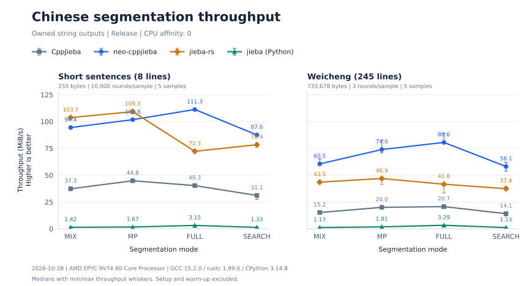

# modern-cppjieba

基于 [CppJieba](https://github.com/yanyiwu/cppjieba) 重写的 C++23 中文分词库，
以头文件形式提供，使用 `neo_cppjieba` 命名空间；另提供适合 C 和其他语言绑定的 C ABI。

- MIX、MP、HMM、FULL、SEARCH 分词，支持用户词典和词性标注。
- UTF-8、UTF-16、UTF-32 输入，返回词语、原文位置和 Unicode 码点位置。
- 借用视图、独立字符串、持有原文的结果，以及可复用的工作区。
- 可选 ICU 适配器，支持 GBK / GB18030 转换及原始字节映射。
- 在编译期选择 CppJieba、jieba-rs 或 Python jieba 分词规则。

[C++ 使用](docs/usage.md) · [构建与安装](docs/building.md) · [C ABI](api/README.md) ·
[应用示例](examples/README.md) · [编码转换](docs/encoding.md) · [更新记录](CHANGELOG.md)

**1.2.0** 增加 C ABI v1、可安装的 CMake 包和本地优先的 GoogleTest 发现。
升级方式见 [1.2.0 发布说明](CHANGELOG.md#120---2026-10-23)。

## 快速开始

使用 CMake 3.20+ 和支持 C++23（包括 `<format>`、`<print>`）的编译器及标准库。
CI 覆盖 GCC 15、LLVM 23 / libc++ 和 Visual Studio 2026，详见 [构建环境](docs/building.md#环境)。

```sh
git clone https://github.com/AkrinW/modern-cppjieba.git
cd modern-cppjieba
cmake -S . -B build -DCMAKE_BUILD_TYPE=Release \
  -DBUILD_TESTING=OFF -DCPPJIEBA_BUILD_EXAMPLES=ON
cmake --build build --config Release --target jieba_basic_cut --parallel
./build/examples/jieba_basic_cut dict "我来到北京清华大学"
```

Visual Studio 生成器的程序路径为 `build/examples/Release/jieba_basic_cut.exe`。

## 使用示例

```cpp
#include "neo/Jieba.hpp"

#include <print>

// Segment text with explicit dictionary and model paths.
int main() {
    const auto jieba = neo_cppjieba::Jieba{
        "dict/jieba.dict.utf8", "dict/hmm_model.utf8", "dict/user.dict.utf8"};
    for (const auto token : jieba.cut("我来到北京清华大学", neo_cppjieba::CutMode::MIX)) {
        std::println("{}", token.word);
    }
}
```

在仓库根目录运行，输出：

```text
我
来到
北京
清华大学
```

构造参数依次为主词典、HMM 模型和用户词典路径；第三个参数传 `""` 可关闭用户词典。
部署时携带这些数据文件，路径及格式见 [词典说明](dict/README.md)。

## CMake 集成

源码接入：

```cmake
add_subdirectory(external/modern-cppjieba)
target_link_libraries(my_app PRIVATE neo_cppjieba::neo_cppjieba)
```

安装后，将安装前缀加入 `CMAKE_PREFIX_PATH`：

```cmake
find_package(neo_cppjieba 1.2 CONFIG REQUIRED)
target_link_libraries(my_app PRIVATE neo_cppjieba::neo_cppjieba)
```

安装命令、可选 ICU 组件和完整选项表见 [构建指南](docs/building.md)。
共享库与静态库接入见 [C ABI 指南](api/README.md)。

## API

`cut` 返回借用原文的 token，`cut_owned` 持有原文，`cut_strings` 返回独立字符串。
批量处理可复用 `Workspace`，并通过 `cut_into` 复用输出数组，或通过 `cut_each` 逐词处理。
使用借用结果期间保持原文有效且稳定。

[分词模式](docs/usage.md#分词模式) · [输出形式](docs/usage.md#选择输出形式) ·
[位置与工作区](docs/usage.md#位置与工作区) · [容量配置](docs/usage.md#容量与错误处理)

## 性能对比

<!-- benchmark:start -->

数据来自 [GitHub Actions](https://github.com/AkrinW/modern-cppjieba/actions/runs/37750171581)，测试日期：2026-10-08。
测量提交：[`44b8f2f`](https://github.com/AkrinW/modern-cppjieba/commit/44b8f2f513bbc65a0f3c679c3b7f07ad50d677ae)。
各实现使用同一主词典和 HMM 模型，关闭用户词典；modern-cppjieba 使用 `CPP` 规则。



吞吐量单位为 MiB/s，越高越好。曲线取各样本的中位数，误差线表示最小、最大吞吐量。
各路径均返回独立字符串，计时覆盖分词、字符串构造和释放；语料读取、词典加载和预热在计时前完成。

- 环境：GitHub 托管 `ubuntu-26.04`，AMD EPYC 7763 64-Core Processor，绑定 CPU 0。
- 工具链：GCC 15.2.0（`-O3 -DNDEBUG`）、rustc 1.99.0（`opt-level=3`）、CPython 3.14.8。
- 比较版本：jieba-rs 0.11.0、Python jieba 0.42.1。
- 语料 `testlines`：8 行、255 字节，每样本 10,000 轮，共 5 个样本。
- 语料 `weicheng`：245 行、733,678 字节，每样本 3 轮，共 5 个样本。

不同实现的分词规则存在差异，词序列差异计数保存在数据快照中。
共享 runner 的耗时会有波动，图表仅代表这次测量。

[测试数据](docs/benchmarks/snapshot.json) · [复现与 CI 更新方法](benchmark/README.md)

<!-- benchmark:end -->

## 开发

[构建与测试](docs/building.md#测试) · [依赖和离线配置](deps/README.md) ·
[性能测量与 CI 更新](benchmark/README.md) · [仓库布局](docs/building.md#仓库布局) ·
[路线图](ROADMAP.md)

## 许可证

[MIT License](LICENSE)。本项目基于 [CppJieba](https://github.com/yanyiwu/cppjieba)，
参考了 [jieba](https://github.com/fxsjy/jieba) 和 [jieba-rs](https://github.com/messense/jieba-rs)。
随库分发的 GTL 使用其 [独立许可证](include/neo/third_party/gtl/LICENSE)。
